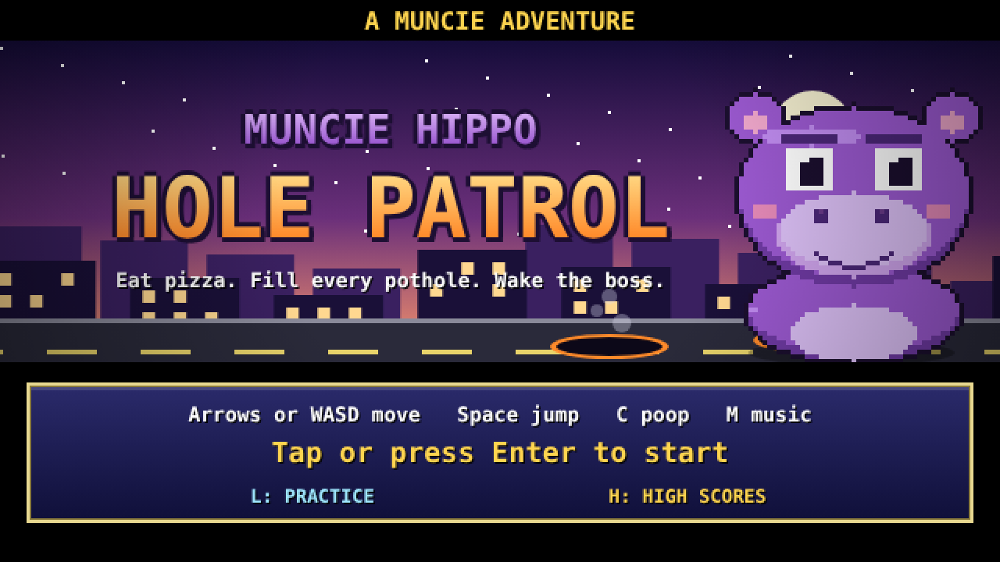
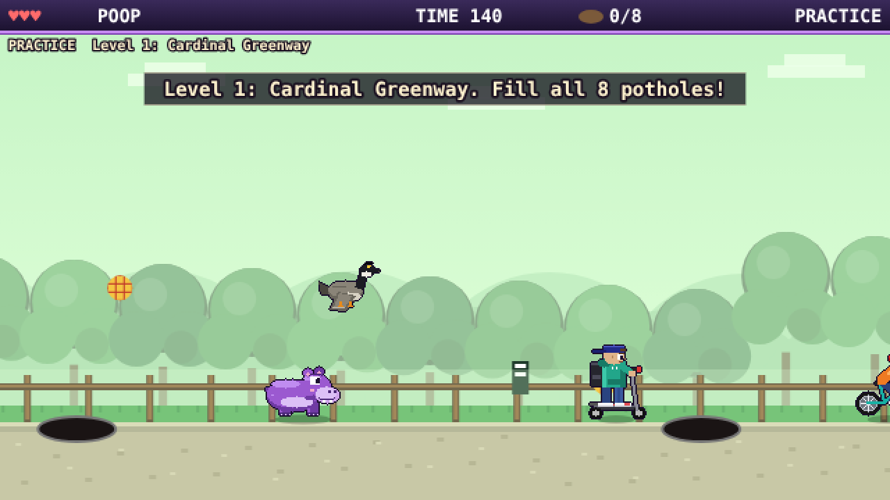
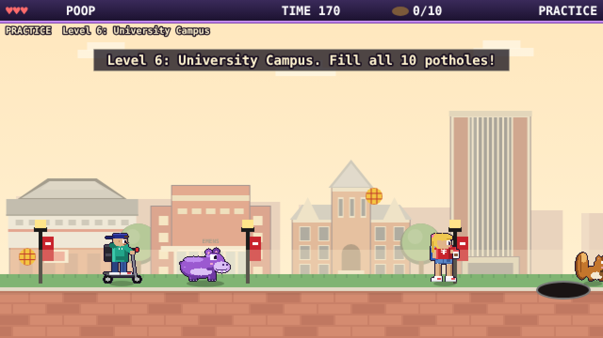
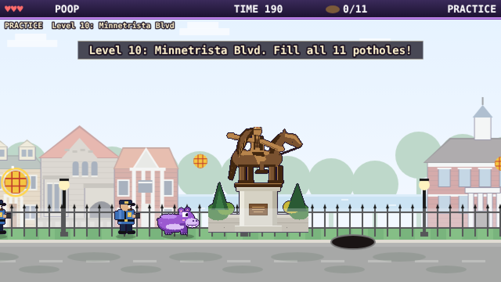
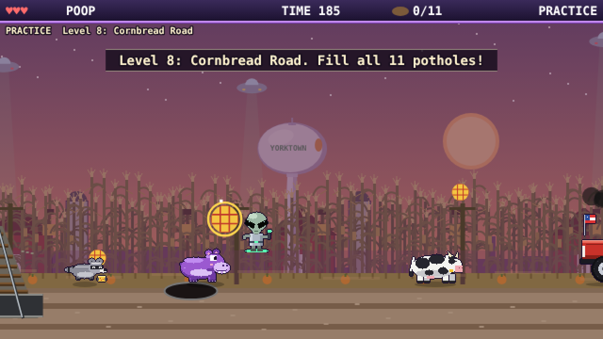
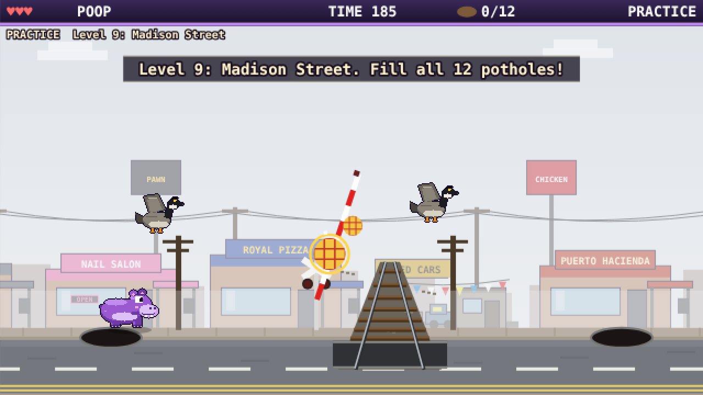
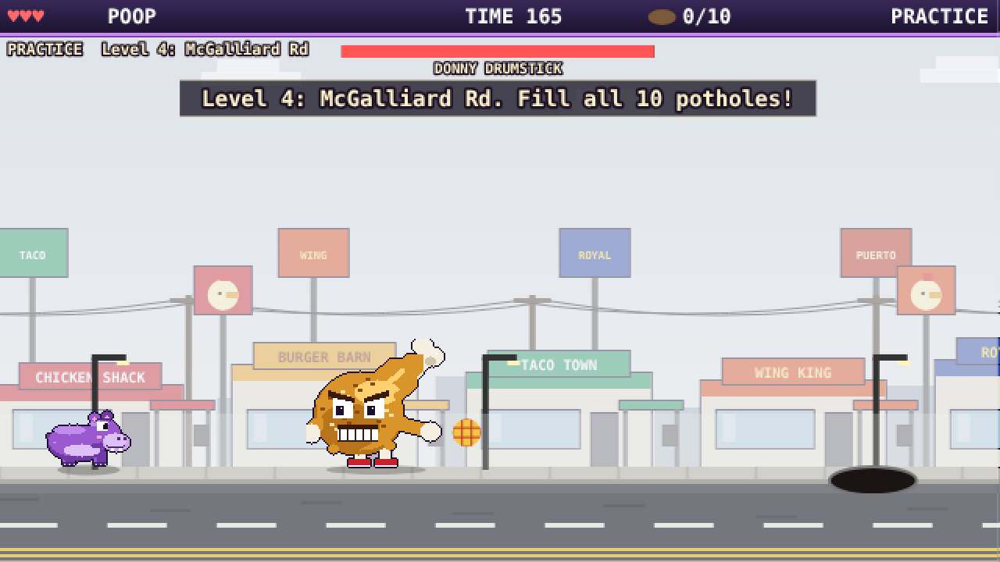

# Muncie Hippo: Hole Patrol

A Sega Genesis-style platformer for your browser. Muncie, Indiana is covered in potholes, and one purple hippo has decided to fix every last one of them his own way: he eats pizza, and what comes out the back fills the hole.

**Play it:** open `index.html` in any modern browser, or use the GitHub Pages link for this repository.

## How it works

- Eat pizza to load up on ammo. Poop fills a pothole, and it also takes out enemies.
- Fill every pothole in a neighborhood to wake that neighborhood's boss, then walk to the landmark at the end of the street.
- Stomp enemies to squash them. Trains, cars and trucks bounce you away and cost you your pizza.
- A mega pizza makes you big, with a shield that takes the next hit.
- A level clock rewards finishing quickly. Hearts come back when you eat pizza on a full tummy.
- Scores are saved on your device, and you can share a score card from the high score screen.

## Controls

**Keyboard**
- Arrow keys or A / D: move
- Space, Up, W or Z: jump
- C, Down or P: poop
- M: music on or off
- Enter: start or continue
- H (title screen): high scores
- L (title screen): level select and practice, with B to toggle the boss

**Phone:** on-screen buttons for left, right, JUMP and POOP appear automatically, and you tap the screen to start.

## Features

- 12 neighborhoods: Cardinal Greenway, Shedtown, Industry, McGalliard Rd, Muncie Mall, University Campus, Old West End, Cornbread Road, Madison Street, Minnetrista Blvd, White River Greenway and Downtown Muncie
- A boss at every landmark, including Rowdy Rocky, Big Bubba, Donny Drumstick, Southside Turkey and Grumpy Gertie
- Landmarks and backdrops drawn from Muncie photos: City Hall, Gillespie Towers, Ball State buildings, the Ball mansions, Minnetrista, the Yorktown water tower, the Appeal to the Great Spirit statue and more
- A big cast of enemies: geese, squirrels, raccoons, possums, pit bulls, herons, flying fish, cats, bikes and scooters, students, co-eds, professors, mall cops, construction workers, painters, cows, UFOs and aliens
- Traffic on the strips, including beater sedans, tuned Hondas, Escalades and yeehaw pickups, plus trains that block the road
- Genesis-era cut screens, a halfway screen and a winning screen
- Practice mode with level select, and a score run through all twelve neighborhoods

## Screenshots

| | |
|---|---|
|  |  |
| A pothole walk on the Cardinal Greenway | University Campus, with scooter kids and co-eds |
|  |  |
| Minnetrista Blvd, with the Ball mansions and the statue | Cornbread Road, with UFOs, aliens and cows |
|  |  |
| Madison Street storefronts | Donny Drumstick on McGalliard Rd |

## Notes

Everything is in one self-contained HTML file with no dependencies. All of the graphics are drawn in code.

The characters and bosses are fictional. Muncie landmarks and a few local business names are used for fun, and no business here has anything to do with this game.
